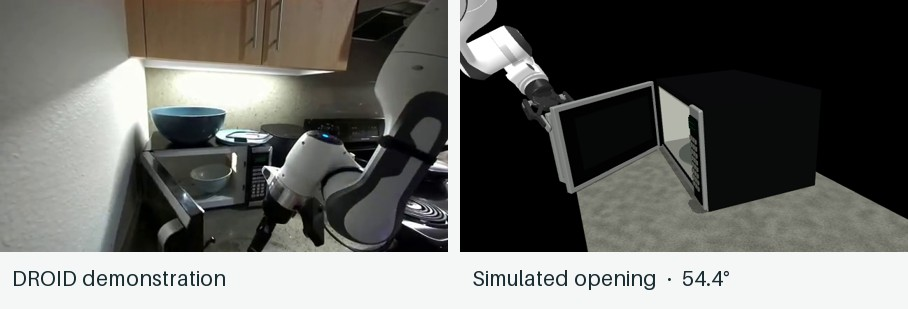
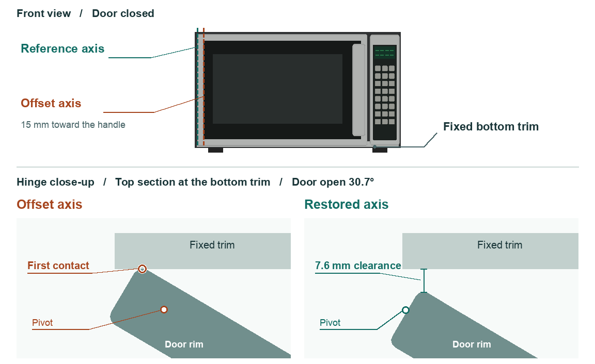
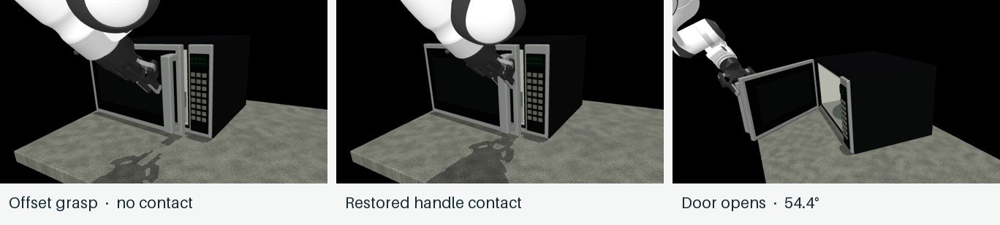

<h1 align="center">RoboRecast: Intent-Preserving Demonstration Augmentation via Diagnosis-Driven Optimization</h1>

<p align="center"><a href="https://autonomierlong.github.io/">Yushi Long</a><sup>1</sup>, <a href="https://juzhan.github.io/">Juzhan Xu</a><sup>1</sup>, <a href="https://brotherhuang.github.io/">Haibin Huang</a><sup>3</sup>, Chi Zhang<sup>3</sup>, Yin Chen<sup>3</sup>, <a href="https://pengsida.net/">Sida Peng</a><sup>1</sup>, <a href="https://csse.szu.edu.cn/staff/ruizhenhu/">Ruizhen Hu</a><sup>2,†</sup>, <a href="https://xzhou.me/">Xiaowei Zhou</a><sup>1</sup></p>

<p align="center">¹ Zhejiang University · ² Shenzhen University · ³ China Telecom<br>† Corresponding author</p>

<p align="center">
  <a href="https://arxiv.org/abs/2611.32622"></a>
  <a href="https://zju3dv.github.io/RoboRecast/"></a>
  <a href="https://zju3dv.github.io/RoboRecast/#video"></a>
</p>


Through diagnosis-driven optimization, RoboRecast augments real-world human and robot demonstrations for new layouts, objects, and robots while preserving task intent.

## Method Overview

RoboRecast identifies the contacts and state changes that define task intent in a real demonstration. The agent maps the roles in each interaction to entities in the target configuration, then uses these requirements to initialize the simulated scene and robot trajectory. If a validity check fails or a rollout misses a required interaction, the agent uses visual and numerical feedback to diagnose the cause, revise the relevant scene or motion parameters, and test the revision.

[Method overview](https://zju3dv.github.io/RoboRecast/#method) · [Demonstration gallery](https://zju3dv.github.io/RoboRecast/#demos)

## Skills & Tools

Open a stage to read its agent skill, or follow a tool link to inspect its implementation.

| Paper stage | Skills | Tools and evidence |
|---|---|---|
| [Task intent analysis](.agents/skills/task-intent-analysis/SKILL.md) | Identify the objects, contacts and state changes that define the task, and specify their order. | [Source keyframes and clips](src/roborecast/observations.py), [SAM 3 masks](src/roborecast/segment.py), [LingBot-Depth estimates](src/roborecast/depth.py), [interaction requirements](src/roborecast/requirements.py) |
| [Scene initialization](.agents/skills/scene-initialization/SKILL.md) | Group objects for modeling, estimate their shapes and poses, and assign material and joint properties. | [AgentSTAR modeling in Blender](third_party/agenticSTAR/harness), [CuACD collision meshes](src/roborecast/collision.py), [material priors](src/roborecast/materials.py), [MJCF assembly](src/roborecast/assembly.py) |
| [Motion initialization and compilation](.agents/skills/motion-initialization/SKILL.md) | Choose approach and grasp poses, waypoint modes, gripper commands and timing. | [Frame transforms, waypoint compiler](src/roborecast/harness.py), [quintic interpolation, SLERP, sequential IK](src/roborecast/motion.py) |
| [Validity checking](.agents/skills/validity-checking/SKILL.md) | Check support, collision geometry, joint travel and robot reachability before rollout. | [Collision overlays, settling and penetration checks, joint sweeps](src/roborecast/inspection.py), [forward kinematics and joint limits](src/roborecast/harness.py) |
| [Diagnosis-driven optimization](.agents/skills/diagnosis-driven-optimization/SKILL.md) | Find the first failed interaction, adjust the scene or waypoints, and verify the repair. | [Rollout contact and state logs](src/roborecast/rollout.py), [rendered keyframes](src/roborecast/keyframe.py), [scene and waypoint edits](src/roborecast/harness.py), [prefix checkpoints](src/roborecast/checkpoints.py) |

**Run a prepared scene.** Follow the [microwave quickstart](examples/microwave/README.md) to reproduce the reference motion, diagnose two failed candidates and verify their repairs.

**Use your own demonstration.** Start with the [tool guide](guides/skills-and-tools.md) for observations, modeling and assembly. The harness reports the candidate’s numerical checks. The main agent compares keyframes with the source to judge visual alignment and whether the action preserves the demonstrated intent. [Instructions for a coding agent](AGENT_TASK.md)

## Quickstart · Open the microwave

A Robotiq gripper pulls the handle, releases it and engages it again to open the door wider. Compare the source demonstration with the simulated opening.



[Watch the source and simulation side by side · 18 s](examples/microwave/media/opening.mp4)

**A misplaced hinge axis.** The closed door looks the same with either pivot. Place the axis 15 mm toward the handle and the door rim swings into the fixed bottom trim at 30.7°. At that same angle, restoring the reference axis leaves 7.6 mm between the two collision pieces. The same pull then opens the door to 54.4°.



**A missed grasp.** Moving the grasp approach outwards leaves the waypoints reachable. Neither pad contacts the handle during the initial pull. Restoring the grasp position brings back contact and opens the door to 54.4°.



[Run the two cases and inspect their reports →](examples/microwave/README.md)

## Code Release Plan

- [x] General-purpose skills and tools for the RoboRecast pipeline
- [ ] DROID example for Real2Sim reconstruction and demonstration augmentation
- [ ] EgoDex example for Human2Robot transfer
- [ ] Mobile ALOHA example for wheeled mobile manipulation

## Citation

```bibtex
@misc{long2026roborecast,
  title = {RoboRecast: Intent-Preserving Demonstration Augmentation via Diagnosis-Driven Optimization},
  author = {Long, Yushi and Xu, Juzhan and Huang, Haibin and Zhang, Chi and
            Chen, Yin and Peng, Sida and Hu, Ruizhen and Zhou, Xiaowei},
  year = {2026}
}
```
