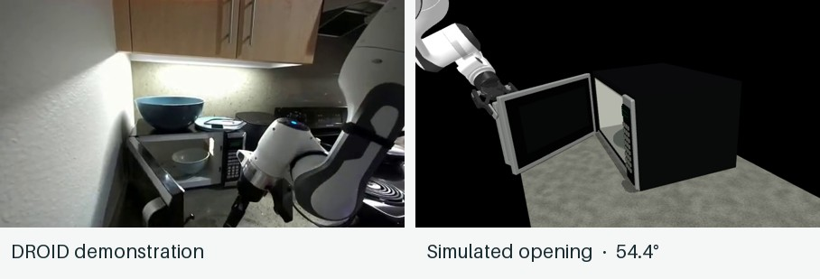
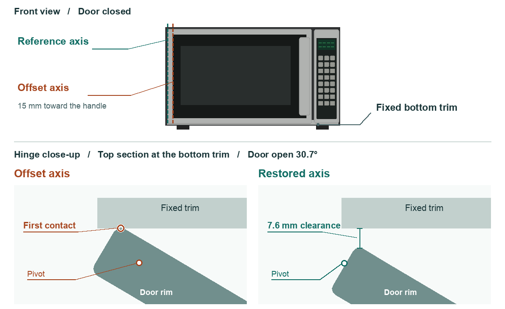
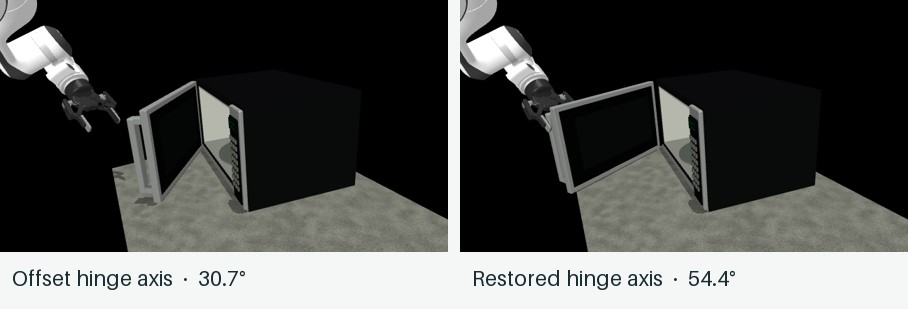
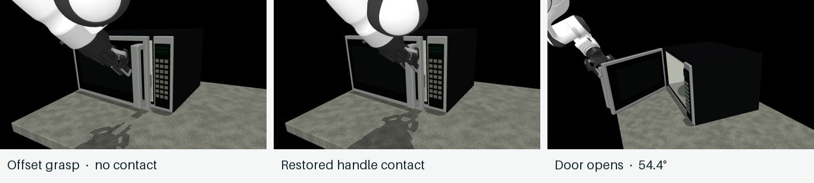

# Open the microwave

A Franka arm with a Robotiq 2F-85 grasps the handle, pulls, releases and makes contact again to swing the door farther open. The simulation starts from an assembled DROID scene. The same initial state, controller and four interaction requirements are used throughout.



[Watch the source and simulation side by side · 18 s](media/opening.mp4)

## Run the reference motion

From the repository root, with Python 3.11:

```sh
python -m venv .venv
source .venv/bin/activate
python -m pip install -e .
python examples/microwave/fetch_arm.py
python -m roborecast.harness examples/microwave --out runs/reference
```

The video runs on the recorded control clock. The source reaches its last frame at 15.66 s and holds there while the simulation finishes.

The last command writes `report.json` and `rollout.npz`. Start with `failed_checks` for the affected check groups, then read the interaction measurements, Cartesian pose error, joint-limit checks and largest penetration. If motion preflight fails, the harness writes only the report and marks the rollout as skipped. The archive stores joint states, actions, handle contacts and hinge angle at each physics step. The reference door opened to **54.4°**. The final acceptable range is **0.85–1.75 rad**.

## Case 1 · The hinge axis is too far inside the door

The closed door gives a good outline of the moving leaf, but its pivot is hidden. In this candidate the vertical hinge axis lies **15 mm toward the handle** from its reference position. A small change in the pivot changes the path of the lower corner as the door swings open.



The dashed lines mark the two axes on the closed door. Below, both panels cut through the same fixed bottom trim at the same door angle. The ring marks the first contact in the offset rollout. The bracket on the right measures the distance between the same two collision pieces after repair.

```sh
B=examples/microwave
python "$B/set_hinge_origin.py" --inset-mm 15 --out runs/offset-axis
python -m roborecast.inspection runs/offset-axis --joint microwave__door_hinge --body microwave --out runs/blocked
python -m roborecast.harness runs/offset-axis --out runs/blocked
```

**Locate the failure.** The approach, initial pull and release all pass. During the second opening, the moving door rim reaches the fixed bottom trim at **30.7°**. The door ends at **30.7°**, short of the **48.7°** minimum. The independent joint sweep identifies the same pair at **41.4°**, where the sampled penetration exceeds its 1 mm tolerance.

**Correct the pivot.** Move the axis back to the modeled hinge edge. The command sets the joint anchor in the door body's local frame. Both candidates use the same collision meshes, robot motion and interaction requirements.

```sh
python "$B/set_hinge_origin.py" --input runs/offset-axis --inset-mm 0 --out runs/restored-axis
python -m roborecast.inspection runs/restored-axis --joint microwave__door_hinge --out runs/repaired-scene
python -m roborecast.harness runs/restored-axis --out runs/repaired-scene
```

At the angle of first contact, the repaired pair has **7.6 mm** of clearance. The sampled joint sweep clears the full **0–105°** range, and the robot opens the door to **54.4°**.



[First contact and repaired clearance](evidence/hinge-contact.json) · [Repaired travel probe](evidence/travel-repaired.json)

## Case 2 · A missed grasp



```sh
python -m roborecast.harness "$B" --edit "$B/grasp-edit.json" --out runs/missed --save-prefixes
python -m roborecast.keyframe "$B" runs/missed/rollout.npz --edit "$B/grasp-edit.json" --time 7 --camera wrist --out runs/missed/close.jpg
```

The grasp and first pull share one world-frame position offset of **−75 mm in x and +40 mm in y**. These waypoints remain reachable. During the first pull, neither pad establishes contact and the door ends the rollout at **3.2°**. Restore the grasp offset to zero and leave the scene fixed:

```sh
python -m roborecast.harness "$B" --resume runs/missed --out runs/repaired-grasp
```

The reference pull maintains left-pad contact for **4.26 s** and right-pad contact for **4.26 s** in the initial-pull window. Read `reused_steps` to see how much of a saved prefix was compatible with the repair. Here the grasp edit changes the approach before the first event boundary, so the repaired run executes from the initial state.

## Follow the evidence

| Result | Earliest unmet interaction | Final opening | Inspect |
|---|---|---:|---|
| Reference | All four pass | 54.4° | [Report](evidence/baseline.json) |
| Offset hinge axis | Wide opening | 30.7° | [Report](evidence/scene.json) · [Travel probe](evidence/travel.json) · [Three-view overlay](evidence/collision-views.jpg) |
| Offset grasp | Initial pull | 3.2° | [Report](evidence/grasp.json) |
| Restored hinge axis | All four pass | 54.4° | [Report](evidence/repair-scene.json) |
| Repaired grasp | All four pass | 54.4° | [Report](evidence/repair-grasp.json) |

To try this with a coding agent, point it to [AGENT_TASK.md](../../AGENT_TASK.md), the prepared offset-axis bundle or the grasp-offset candidate. Ask it to diagnose the earliest failure and repeat the rollout after changing the relevant variable.

[Bundle formats and optional modeling tools](../../guides/skills-and-tools.md) · [Source and asset credits](../../THIRD_PARTY.md)
