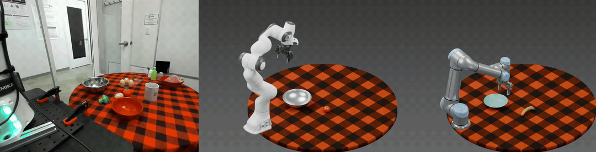
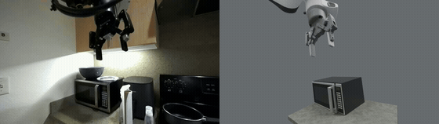
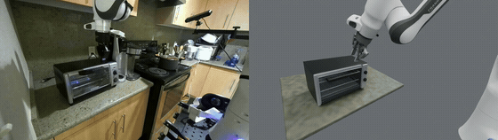
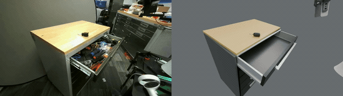
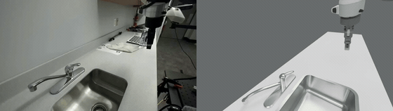

# DROID · Real2Sim and Augmentation

Reconstruct a single-arm demonstration from three calibrated RGB-D views and robot actions. The same interaction requirements guide transfer to a different robot, object or layout.



**Project-page example, left to right** · DROID demonstration, FR3 reconstruction, UR5 banana augmentation. The runnable example below transfers the task to a UR5e with a Robotiq 2F-85.

## DROID · Articulated Examples

Each pair shows the DROID demonstration on the left and its reconstruction on the right.

<table>
  <tr>
    <td width="50%" align="center"><strong>Open the microwave</strong><br></td>
    <td width="50%" align="center"><strong>Open the oven</strong><br></td>
  </tr>
  <tr>
    <td width="50%" align="center"><strong>Place a screwdriver in the drawer and close it</strong><br></td>
    <td width="50%" align="center"><strong>Rotate the faucet spout</strong><br></td>
  </tr>
</table>

## Run an episode

Run these commands from the repository root on a Linux research host. Install RoboRecast into the simulation Python environment with `python -m pip install -e . h5py opencv-python-headless`. The offline converter needs FFmpeg, FFprobe, the ZED SDK and its matching `pyzed` bindings, MuJoCo, h5py, OpenCV and SciPy. The modeling environment uses Blender and CuACD, plus SAM 3 and LingBot-Depth with their checkpoints. [Backend installation and tool commands](../../guides/skills-and-tools.md)

Supply local tool paths through `BLENDER`, `SAM3_PYTHON`, `SAM3_CHECKPOINT`, `LINGBOT_PYTHON`, `LINGBOT_ROOT`, `LINGBOT_CHECKPOINT` and `CUACD_PYTHON`. For the gallery banana, point `ROBORECAST_ASSET_DIR` to a local asset directory containing the YCB 011 textured scan. The recipe also permits modeling the banana in Blender. [YCB object models](https://www.ycbbenchmarks.com/object-models/)

### 1. Prepare the raw recording

The example uses episode `REAL+4dbb5646+2023-07-25-14h-46m-02s`. Retrieve this recording from DROID's raw bucket and the two camera calibration catalogs. Use a DROID checkout for the robot mesh tree and the ZED camera settings for the three serials in the recording metadata. [DROID data access](https://droid-dataset.github.io/droid/the-droid-dataset.html) · [Camera catalogs](https://huggingface.co/KarlP/droid/tree/main)

```sh
D=pipelines/droid
DATA="$PWD/data/droid"
ID='REAL+4dbb5646+2023-07-25-14h-46m-02s'
RECORDING='Tue_Jul_25_14:46:02_2023'
mkdir -p "$DATA/raw" "$DATA/catalog" "$DATA/FR3"
gsutil -m cp -r "gs://gresearch/robotics/droid_raw/1.0.1/REAL/success/2023-07-25/$RECORDING" "$DATA/raw/"
for file in intrinsics.json cam2base_extrinsic_superset.json; do
  curl -fL "https://huggingface.co/KarlP/droid/resolve/main/$file" -o "$DATA/catalog/$file"
done
git clone https://github.com/droid-dataset/droid.git "$DATA/droid-code"
git -C "$DATA/droid-code" checkout 33ae6a67274f36d2e29525b86f23a56616ef43a7
mkdir -p "$DATA/FR3/droid/droid/robot_ik"
cp -R "$DATA/droid-code/droid/robot_ik/franka" "$DATA/FR3/droid/droid/robot_ik/"
```

Download the factory calibration for the three serials in this recording. Existing ZED settings with the same serials can also be used.

```sh
ZED_SETTINGS="$DATA/zed-settings"
mkdir -p "$ZED_SETTINGS"
for serial in 11744905 20540549 23960472; do
  curl -fL "https://calib.stereolabs.com/?SN=$serial" -o "$ZED_SETTINGS/SN$serial.conf"
done
```

Run the converter with the ZED-enabled Python. It reads the three MP4/SVO pairs and `trajectory.h5`, aligns ZED depth to the RGB proxies, and records actions, calibration, measured robot states and timestamps.

```sh
python "$D/prepare.py" --raw "$DATA/raw/$RECORDING" --catalog "$DATA/catalog" \
  --robot-assets "$DATA/FR3" --zed-settings "$ZED_SETTINGS" --output "$DATA/prepared"
EPISODE="$DATA/prepared/input/episodes/$ID"
```

A prepared episode can be reused across runs. Keep its sibling `input/shared` directory with it. For another recording, supply its own successful episode metadata and matching robot family, camera serials and calibration. Some older recordings use unprefixed arm serials. The converter can resolve them from an exact matching prefixed serial in the catalog's `candidate_metadata` directory.

### 2. Reconstruct the FR3 demonstration

Before your first agent run, follow [Configure your agent](../../guides/skills-and-tools.md#configure-your-agent).

```sh
python "$D/run.py" reconstruct --episode "$EPISODE" --out runs/droid/tomato
```

The launcher prepares a calibrated robot base with the complete 2F-85. A single owner agent reads the prepared evidence, models the support and task objects, binds ordered interactions to waypoints and repairs failed candidates in simulation. The same agent runs final verification and repairs any failure within its 40-minute default budget. Each run uses a fresh output directory.

### 3. Transfer to UR5e, banana and ceramic bowl

Supply the UR5e arm meshes from MuJoCo Menagerie. Both arms and the microwave tutorial use the [shared Robotiq 2F-85](../../robots/robotiq_2f85). [UR5e model and assets](https://github.com/google-deepmind/mujoco_menagerie/tree/eea4c7431b63da8278b0ff31638e0b0e941cec0e/universal_robots_ur5e)

```sh
git clone --filter=blob:none --sparse https://github.com/google-deepmind/mujoco_menagerie.git "$DATA/menagerie"
git -C "$DATA/menagerie" sparse-checkout set universal_robots_ur5e
git -C "$DATA/menagerie" checkout eea4c7431b63da8278b0ff31638e0b0e941cec0e
python "$D/run.py" augment --episode "$EPISODE" --source runs/droid/tomato \
  --recipe "$D/examples/tomato/recipe.json" --ur5e-meshes "$DATA/menagerie/universal_robots_ur5e/assets" \
  --out runs/droid/banana
```

The recipe changes the robot, both objects and their relative placement in one run. To retain the source arm, set `"robot": "source"` and omit the UR5e mesh option. Each new grasp follows the fruit and each placement follows the new receptacle. The agent rebinds named source entities and translates position tolerances using the new scene anchors. Contact durations, tolerance widths, interaction order, required physical checks and passive observables carry over. Repeated agent runs can yield different models and motions. [Example recipe](examples/tomato/recipe.json) · [Binding implementation](binding.py)

## Inspect a result

| Output in the run directory | What it contains |
|---|---|
| `intent.json` and `bundle/` | Bound interactions, assembled scene, robot runtime, waypoints, physical checks and observables |
| `rounds/` | Candidate reports, failed predicates, contact/state traces and reusable prefixes |
| `visual-review.json` | The owner's source and simulated keyframes and visual judgment |
| `accepted.json` and `final/` | Result of an independent final replay, control and state trace, and measured operation-duration comparison |

For the UR5e run, the source fruit-to-bowl vector points left and forward. The augmented vector points right and forward. It changes by **17.2 cm** and rotates **40.6°**, leaving **25.3 cm** between the new centers. The ceramic bowl measures **23.8 cm** across, compared with **20.5 cm** for the steel bowl. The contact trace records both pads on the banana, a **15.4 cm** peak lift and contact with the bowl after release. [Numerical evidence](examples/tomato/result.json) · [Target waypoints](examples/tomato/waypoints.json)

In a separate cold-start run, reconstruction took **8 min 03 s** and augmentation of that output took **6 min 48 s**. Both final replays passed all six interactions. The target spacing was **25.1 cm**. The launcher records wall time including agent execution, verification and connection waits. Report any documented outage separately and subtract it when quoting active runtime. Raw data preparation, presentation rendering and dataset export are timed separately.

For that cold-start augmentation, the observed manipulation windows were **12.68 s** for the source FR3 and **12.83 s** for the simulated UR5e. Both use the first and last intervals with end-effector speed above 5 mm/s or angular speed above 0.05 rad/s, including intervening pauses. Both recordings end during motion, so their natural stopping times are unknown. [Operation-duration measurement](timing.py)

Augmentation and export check the saved candidate and trajectory against their acceptance fingerprint. If you edit a run, update its evidence and run `python "$D/run.py" verify PATH_TO_RUN`. A reconstruction accepted with an older release can be verified once with this command before reuse.

Export the accepted control transitions to HDF5 after the agent exits. Each control advances one recorded state to the next. Optional camera samples carry indices into the same simulation clock.

```sh
python "$D/export.py" runs/droid/banana --out runs/droid/banana.h5 --camera ext1 --fps 10
```

[Five skills and tool reference](../../guides/skills-and-tools.md) · [Microwave diagnosis quickstart](../../examples/microwave/README.md)
