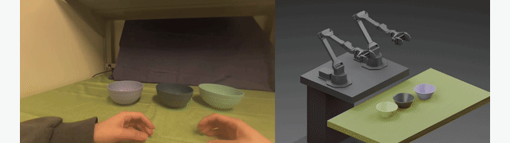
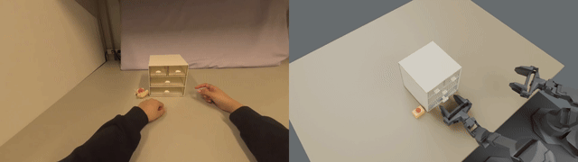

# EgoDex · Human2Robot Transfer

Convert a monocular human demonstration into a physically executed trajectory for two fixed VX300S arms with parallel grippers. Camera poses and tracked fingertips give metric references for reaching and grasping. The robot creates contact and moves each object in MuJoCo.

<table>
  <tr>
    <td width="50%" align="center"><strong>Stack Bowls</strong><br></td>
    <td width="50%" align="center"><strong>Place a Toy in the Drawer</strong><br></td>
  </tr>
</table>

| Example | Official test episode | Evidence to inspect |
|---|---|---|
| Stack Bowls | `stack_unstack_bowls/0` | The left arm stacks the lavender bowl into the teal bowl. The right arm then stacks the green bowl into the lavender one. Inspect both grasps, release order and support. |
| Place a Toy in the Drawer | `insert_remove_drawer/8` | The left gripper opens the drawer through handle contact, lifts the toy, releases it onto the drawer floor and leaves the drawer nearly closed. Inspect the slide position, pad forces and final containment. |

## Prepare an episode

Run from the repository root on Linux with Python 3.11, FFmpeg and FFprobe. Install the simulation package with `python -m pip install -e . h5py opencv-python-headless`. For segmentation, set `SAM3_PYTHON` to the Python executable with SAM 3 installed and `SAM3_CHECKPOINT` to its checkpoint. Set `BLENDER` to the Blender executable for native scene modeling. [Installation and tool reference](../../guides/skills-and-tools.md)

Download the official EgoDex test release and extract the two MP4/HDF5 pairs with their original task directories and numeric filenames. Set `TEST` to the extracted test directory. [Official data and download instructions](https://github.com/apple-aiml-research/ml-egodex)

```sh
D=pipelines/egodex
TEST=/path/to/egodex/test
python "$D/prepare.py" --rgb "$TEST/stack_unstack_bowls/0.mp4" \
  --poses "$TEST/stack_unstack_bowls/0.hdf5" --output runs/egodex/inputs/bowls
python "$D/prepare.py" --rgb "$TEST/insert_remove_drawer/8.mp4" \
  --poses "$TEST/insert_remove_drawer/8.hdf5" --output runs/egodex/inputs/drawer
```

The offline converter prepares original RGB, camera intrinsics and poses, source timestamps, metric hand references with validity masks, and a sparse contact sheet. The scene initialization uses calibrated RGB observations, camera motion and hand references. The input requires neither sensor depth nor source robot commands.

## Run an episode

Sign in on the simulation host as described in [Configure your agent](../../guides/skills-and-tools.md#configure-your-agent). Each command below starts one owner in a fresh workspace. Use either independently.

```sh
python "$D/run.py" --episode runs/egodex/inputs/bowls --example stack-bowls --out runs/egodex/bowls
python "$D/run.py" --episode runs/egodex/inputs/drawer --example toy-in-drawer --out runs/egodex/drawer
```

The launcher registers the episode’s modeling and simulation tools with your Codex CLI. It defaults to GPT-6-Astra with medium reasoning effort and a 40-minute episode budget. Use `--model` and `--agent` to select your model and Codex executable. For another official recording, prepare its original pair and replace `--example` with `--task "operation to check against the source"`.

The owner reads the source, identifies the acting hand and contact windows, models the task objects and support, and chooses mutually reachable poses for the two fixed arms. It compiles object-relative goals on a shared clock, physically executes them, and uses contact diagnostics and sparse frames to repair failed interactions. Compatible prefixes can be reused. The final visual assessment names the passing rollout. [Episode instructions](owner.md) · [Sparse motion and physical checks](motion.md)

## Inspect and export

```sh
python "$D/export.py" runs/egodex/bowls runs/egodex/delivery/bowls --render
python "$D/export.py" runs/egodex/drawer runs/egodex/delivery/drawer --render
```

| Delivery file | Contents |
|---|---|
| `observations_actions.npz` | Recorded full-system positions and velocities, timestamps, actuator controls and consecutive state indices. Each action advances its observation to its successor. |
| `final_result.json` | Physical rollout and review identities, actuator order, source operation window, corresponding simulation phases and measured left/right gripper motion. |
| `simulation.mp4`, `comparison.mp4` | Optional Blender simulation and human/robot comparison. Each plays at native speed, aligned to its operation start. Omit `--render` for data-only export. |

The Blender exporter defaults to CUDA. Set `ROBORECAST_RENDER_DEVICE=CPU` for a CPU-only machine or `OPTIX` for an OptiX device.

## Example runs

The gallery shows the project-page recordings. The table reports results for the two official episodes above. **Initial owner time** runs from a prepared episode to the end of the autonomous session. **Operation time** compares the human interaction window with the corresponding robot phases in the verified replay.

| Example | Initial owner time | Human → robot operation | Physical result |
|---|---:|---:|---|
| Stack Bowls | 22 min 45 s | 5.53 → 25.27 s | The left gripper placed the lavender bowl in the teal bowl. The right gripper then placed the green bowl in the lavender one. Both releases and all three final support contacts passed. |
| Place a Toy in the Drawer | 18 min 43 s | 3.13 → 22.30 s | The drawer reached 8.77 cm open during the opening check. At the end the slide was within 0.01 mm of closed, and the released toy rested on the floor with 2.13 cm of clearance from the nearest edge. |

The initial bowls trajectory took 26.23 s. Replay exposed sustained contact between a gripper housing and a bowl. We adjusted the supporting gripper’s pose and the second placement and release, then replayed the full trajectory. Both examples passed the source-interaction and sustained-contact checks. Offline refinement, data preparation, export and Blender rendering are outside the reported owner times.
