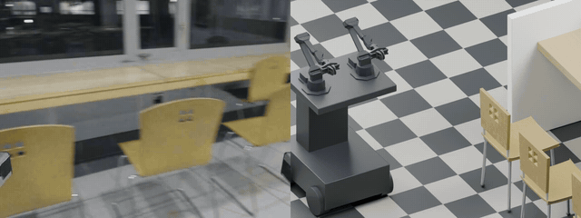

# Mobile ALOHA · Wheeled Mobile Manipulation

Reconstruct a mobile manipulation demonstration with a Tracer base and two ViperX 300 arms. The agent uses the body-mounted camera, both wrist cameras and the recorded robot signals to place relevant objects, plan a route and execute the interaction in MuJoCo.

<p align="center"><strong>Push a Chair</strong><br>
</p>

The project-page clip shows the first chair. The runnable example uses the full recording. The robot pushes two chairs toward the counter, then establishes contact with a third as the recording ends. A neighboring chair constrains the final approach.

## Prepare an episode

Run the commands from the repository root on Linux with Python 3.11 and FFmpeg. Install the simulation package and HDF5/video readers. Download `aloha_mobile_chair_truncated/episode_1.hdf5` from the dataset linked on the official project page. [Mobile ALOHA dataset](https://mobile-aloha.github.io/)

```sh
python -m pip install -e . h5py opencv-python-headless
M=pipelines/mobile_aloha
SOURCE=/path/to/aloha_mobile_chair_truncated/episode_1.hdf5
python "$M/prepare.py" --source "$SOURCE" --output runs/mobile_aloha/inputs/chairs
```

Preparation decodes three RGB streams, preserves their HDF5 row correspondence with arm states and commands, and integrates the measured forward and yaw velocities from an initial local pose of zero. The integrated route is a prior. The bundle contains the robot, its approximate camera mounts, source keyframes and the route summary. This example has 2,000 rows at 50 Hz and spans 39.98 s.

## Run an episode

Sign in on the simulation host using the shared agent guide. The launcher starts one owner in a fresh output directory, with GPT-6-Astra at medium reasoning effort by default. Use `--model` and `--agent` to select a model and Codex executable. [Configure your agent](../../guides/skills-and-tools.md#configure-your-agent)

```sh
python "$M/run.py" --episode runs/mobile_aloha/inputs/chairs \
  --example push-a-chair --out runs/mobile_aloha/chairs
```

For another recording in the same format, prepare its HDF5 and pass `--task "operation to verify against the demonstration"` in place of `--example`. The owner reads the prepared source observations and performs the following steps.

| Stage | What to inspect |
|---|---|
| Scene initialization | Source frames and arm forward kinematics anchor the chair backrests, floor, counter and nearby obstacles. Sparse views show the available approach and pushing clearance. |
| Motion compilation | One sequence specifies the base motion, sparse arm waypoints and gripper openings. The compiler converts it to synchronized, rate-limited robot targets. |
| Diagnosis and repair | A stage probe reports contacts, object displacement, tilt and collisions. The owner repairs the earliest responsible phase and can reuse passing prefix checkpoints. |
| Acceptance | The full rollout must satisfy the source interactions and the final object relations. The owner checks source and simulated images, including obstacle placement and the final contact, and records a verdict for that rollout. |

The Tracer integrates forward speed and yaw rate on the floor. Wheel geometry is visual. The arms use actuators, and robot contacts and friction move the freely simulated chairs. Camera poses are fixed relative to the robot. [Owner instructions](owner.md) · [Scene modeling](references/scene-format.md) · [Waypoints and physical checks](references/trajectory-format.md)

## Inspect and export

On a headless Linux host with EGL support, select EGL when exporting the comparison video.

```sh
MUJOCO_GL=egl python "$M/export.py" runs/mobile_aloha/chairs runs/mobile_aloha/delivery/chairs --render
```

For a data-only export, omit `--render` and the `MUJOCO_GL` setting.

To verify a delivery on another machine, copy its entire directory and run the following command.

```sh
python "$M/replay.py" runs/mobile_aloha/delivery/chairs
```

The exporter packages the accepted scene and replays the base and actuator commands together, comparing positions and velocities at every saved observation. If the prepared episode has moved, pass its new location with `--episode` when rendering. Preparation, delivery and rendering run outside the owner budget.

| Delivery file | Contents |
|---|---|
| `scene.xml`, `assets/` | Portable MuJoCo scene and meshes. |
| `observations_actions.npz` | Initial integration state, body-frame base commands in `step_twist` (forward m/s, lateral m/s fixed to zero, yaw rad/s), applied actuator controls in `step_control`, and measured base, robot and object states at observation times. `row_end_step[i]` counts the steps applied to reach observation `i`. |
| `phases.json`, `diagnostics.json`, `review.json` | Executed phases, contact and object evidence, and the owner’s assessment. |
| `final_result.json` | Rollout revision, actuator/body names in array order, physics timestep and maximum replay errors. |
| `comparison.mp4` | A 3×3 grid. The top row shows the three source cameras, the middle row shows the matching simulated cameras, and the bottom row shows three external simulation views. Frames are matched by source observation index and played on the simulation timeline. |

## Verified example

Both runs below use the same 39.98 s source recording. The distances are the horizontal displacements of the first and second chairs over the full simulation.

| Candidate | Full rollout | Chair 1 / Chair 2 | Terminal interaction |
|---|---:|---:|---|
| Archived candidate, recompiled with the release tools | 58.07 s | 0.60 m / 0.67 m | Both hands contact the third backrest. |
| Fresh Codex owner, independently replayed | 59.98 s | 0.54 m / 0.54 m | Both hands contact the third backrest. |

The fresh owner took **19 min 05 s** from the prepared input through visual acceptance, including 18 full rollouts. It adjusted gripper contact and approach speed to satisfy the motion limits. The final release tools reproduced its recorded positions and velocities at all 2,000 observations using 11,996 physics steps. The scene uses approximate camera mounts and simplified chair geometry; camera framing and approach timing differ from the demonstration.
